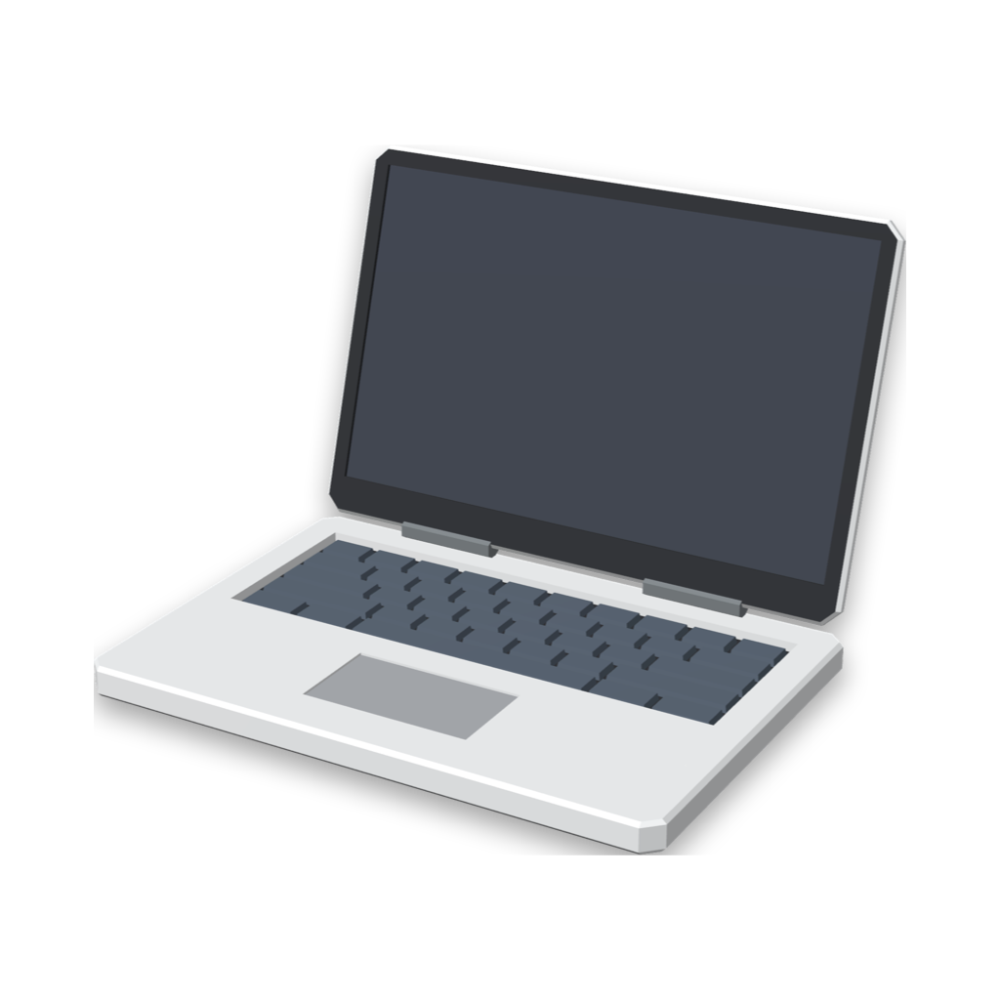

# Display Scale

Display Scale puts a resolution slider in the macOS menu bar, and it adds larger "looks like" sizes to the built-in display of your Mac.

On a laptop, macOS stops at **More Space**. For example, a 14-inch MacBook Pro stops at 1800 × 1169. Display Scale can add sizes above that limit, such as 2048 × 1330 and 2200 × 1428. These sizes stay sharp (HiDPI), and they show more on the screen with smaller text. This is useful for video editing, code, and other work that needs space.

- **Menu bar slider:** Click the display icon and drag the slider. When you release it, the screen changes to that size.
- **Guided setup:** On the first start, a setup window suggests two custom sizes for your laptop and adds them for you.
- **Command line tool:** `res` does the same work in Terminal, for example `res more` or `res 2200`.

> [!NOTE]
> Display Scale works on Mac computers with Apple silicon, with macOS 13 or later. It changes only the built-in display.
> If something does not work on your Mac, please [open an issue](https://github.com/utsavsingh899/display-scale/issues), and include your Mac model and macOS version.

## Contents

- [Requirements](#requirements)
- [Install](#install)
- [Set up your custom sizes](#set-up-your-custom-sizes)
- [Use the slider](#use-the-slider)
- [The menu](#the-menu)
- [The res command](#the-res-command)
- [Performance, battery, and heat](#performance-battery-and-heat)
- [Problems and solutions](#problems-and-solutions)
- [Uninstall](#uninstall)
- [How it works](#how-it-works)
- [Build from source](#build-from-source)
- [Benchmarks (optional)](#benchmarks-optional)
- [License](#license)

## Requirements

- A Mac with Apple silicon (M1 or later).
- macOS 13 Ventura or later.
- An administrator account. The setup asks for your password one time.
- If you use BetterDisplay, SwitchResX, or a similar app: remove its display changes for the built-in display first. See [Another display override exists](#another-display-override-exists).

## Install

Download `display-scale-<version>.zip` from the [latest release](https://github.com/utsavsingh899/display-scale/releases/latest). Then use one of these two methods.

### Method A: the install script (recommended)

1. Double-click the zip file to unzip it. You get a `display-scale` folder.
2. Open Terminal and go to that folder. For example, if the folder is in Downloads:
   ```bash
   cd ~/Downloads/display-scale
   ```
3. Run the install script:
   ```bash
   bash install.sh
   ```

The script does these steps:

- It copies `Display Scale.app` to `/Applications` and removes the download quarantine flag, so macOS does not block the app.
- It copies the `res` and `displaymode` commands to `~/.local/bin`. If `~/.zshrc` does not add that folder to your `PATH`, the script adds one line.
- It opens Display Scale. The setup window comes up. Go to [Set up your custom sizes](#set-up-your-custom-sizes).

### Method B: only the app

1. Double-click the zip file to unzip it.
2. Drag `Display Scale.app` from the `display-scale` folder to your **Applications** folder.
3. Double-click Display Scale in Applications. macOS shows a message that it cannot check the app. Click **Done**.
4. Open **System Settings > Privacy & Security**. Scroll down to the **Security** section. Next to "Display Scale was blocked", click **Open Anyway**, and type your password.
5. Display Scale opens, and the setup window comes up.

macOS blocks the app because it does not have an Apple Developer ID signature. The app has only an ad-hoc signature. All the source code is in this repository, so you can also [build it yourself](#build-from-source).

## Set up your custom sizes

The setup window takes you through these steps. It comes up when you open Display Scale for the first time.

### 1. Display Scale reads your display

Display Scale records the standard sizes of your built-in display in `~/.config/res/stock`. It must do this before any custom size exists. Then it shows these values:

- The number of pixels on your display, for example 3024 × 1964.
- The largest standard size, **More Space**, for example 1800 × 1169.

### 2. Select two custom sizes

The window suggests two widths. They give text at about **88%** and **82%** of the text size at More Space. Display Scale calculates the height from the shape of your screen.

| Mac | Pixels | More Space | Suggested sizes |
|---|---|---|---|
| MacBook Pro 14-inch (M5) | 3024 × 1964 | 1800 × 1169 | 2048 × 1330 (88%), 2192 × 1423 (82%) |
| MacBook Air 13-inch (M1) | 2560 × 1600 | 1680 × 1050 | 1912 × 1195 (88%), 2048 × 1280 (82%) |

The window calculates these values for your Mac, so you do not need this table. You can type other widths. These rules apply:

- A width must be larger than the width of More Space.
- A width can be 3072 at most. Apple silicon draws a HiDPI size at 2× its width, and the limit is 6144 pixels.
- To add only one size, leave the second field empty.

The window shows the full size and the text size for each width before you continue. For example, I use 2048 and 2200 on the 14-inch MacBook Pro.

### 3. Add the sizes

Click **Add Sizes…**. macOS asks for your password. Display Scale then writes one file:

```
/Library/Displays/Contents/Resources/Overrides/DisplayVendorID-<id>/DisplayProductID-<id>
```

If an old file is there, Display Scale moves it to the Trash first.

### 4. Restart the Mac

macOS reads the new sizes only when the Mac starts. Click **Restart Now…** and confirm, or restart later from the Apple menu.

### 5. Make sure that the sizes are there

After the restart, open Display Scale. If you turned on **Open at Login**, it opens by itself. The setup window then tells you one of these results:

- **"Your new sizes are ready."** Turn on **Open Display Scale at login** if you want the slider at each login. Click **Done**.
- **"macOS did not load the new sizes."** This method does not work on that Mac or macOS version. Click **Remove Sizes…** to go back to the standard list, and please [open an issue](https://github.com/utsavsingh899/display-scale/issues).

To skip the custom sizes, click **Not Now**. The slider then has only the standard sizes. You can add custom sizes later from the menu.

## Use the slider

1. Click the display icon in the menu bar.
2. Drag the slider. It stops at each size. The label below the slider shows the size, for example "82% of More Space · 2200 × 1428".
3. Release the slider. The menu closes, and the screen changes to that size in about one second.

The size stays after a restart.

The size changes when you release the slider, not while you drag it. Each change draws the whole screen again, so a change at each stop makes the screen flash many times.

The custom sizes are also in System Settings. Open **System Settings > Displays**, Control-click the size pictures, and select **Show List**. Then turn on **Show all resolutions**.

## The menu

| Item | What it does |
|---|---|
| Display Size slider | Changes the size of the built-in display. |
| Set Up Custom Sizes… | Opens the setup window, so you can change your custom sizes. A change needs your password and a restart. |
| Remove Custom Sizes… | Moves the override file to the Trash. After a restart, only the standard sizes are available. |
| Open at Login | Starts Display Scale each time you log in. |
| Quit Display Scale | Closes the app. The current size stays. |

## The res command

`res` does the same work as the app, in Terminal. The install script puts it in `~/.local/bin`. The app and `res` use the same files, so they always agree.

| Command | What it does |
|---|---|
| `res` or `res list` | Shows the presets and the command for each one. `*` marks the current size. |
| `res <preset>` | Changes to a preset, for example `res default`, `res more`, or `res 2200`. |
| `res <width>x<height>` | Changes to any HiDPI size that macOS has, for example `res 1800x1125`. |
| `res setup` | Makes the presets for this Mac and suggests custom widths. |
| `res setup <width> ...` | Makes the presets with these custom widths, for example `res setup 2048 2200`. |
| `res install` | Writes the override file with your custom sizes. It asks for your password. Restart after it. |
| `res uninstall` | Moves the override file to the Trash. It asks for your password. Restart after it. |
| `res help` | Shows the commands. |

This is the output of `res list` on a 14-inch MacBook Pro:

```
  COMMAND      SIZE       NOTE
  res larger   1024x665   Larger Text
  res 1147     1147x745
  res 1352     1352x878
  res default  1512x982   Default
  res more     1800x1169  More Space
  res 2048     2048x1330  88% of More Space
* res 2200     2200x1428  82% of More Space
```

To rename or remove a preset, edit `~/.config/res/presets`. The slider shows the change the next time you open the menu.

`displaymode` is the low-level tool that `res` and the app use. Run `displaymode list` to see all the modes of the display, including the low-resolution modes.

## Performance, battery, and heat

macOS draws a HiDPI size at 2× its width and height, and then scales the image down to the screen. A larger size makes more pixels for each frame. For example, 2200 × 1428 draws 4400 × 2856 pixels, which is 2.12× the pixels of the screen.

I measured the effect on one Mac: a MacBook Pro 14-inch (M5, 16 GB) with macOS 27, on battery power, with some apps open. The results on your Mac can be different.

| Measurement | Default (1512 × 982) | 2200 × 1428 | Difference |
|---|---|---|---|
| GPU power, normal desktop | 0.48 W | 1.01 W | +0.53 W |
| GPU power, full-screen moving image | 0.12 W | 0.23 W | +0.11 W |
| GPU work at full load | 2649 GFLOP/s | 2436 GFLOP/s | 8% less |

What this means in use:

- **Daily work** (web, code, documents, video): You do not see a difference in speed. At full load the GPU uses about 17 W, so the extra 0.5 W is small.
- **Battery:** With light work, the battery lasts about 7% less (for example 9.8 hours instead of 10.5 hours). With heavy work, the difference is about 2–3%.
- **Heavy GPU work** (for example video effects, or an export that uses the GPU fully): This can be up to 8% slower. If this is important, change to Default before the export.
- **Text:** At Default, one drawn pixel is one screen pixel, so text is as sharp as possible. At a larger size, macOS scales the image down, so text is a little softer.
- **Memory:** Each window buffer is larger. A full-screen window uses about 50 MB at 2200 × 1428 and about 24 MB at Default.

To measure your own Mac, see [Benchmarks](#benchmarks-optional).

## Problems and solutions

### The new sizes are not there after the restart

The setup window shows "macOS did not load the new sizes". Click **Remove Sizes…** and restart. This method may not work on that Mac or macOS version. Please [open an issue](https://github.com/utsavsingh899/display-scale/issues), and include the output of `displaymode info` and `sw_vers`.

### Another display override exists

The setup window shows this message when it finds a display override that another app made, for example BetterDisplay. While that file is there, Display Scale cannot read the standard sizes of your display.

1. In the other app, turn off its changes to the built-in display. Then quit and uninstall it.
2. In the setup window, click **Remove Override…** and type your password. The file goes to the Trash.
3. Restart the Mac.
4. Open Display Scale. The setup starts again.

### macOS blocks the app

Use the install script (Method A), or click **Open Anyway** in **System Settings > Privacy & Security** (Method B).

### The slider shows "The built-in display is off"

The lid is closed, or macOS uses only an external display. Display Scale changes only the built-in display.

### Terminal shows "res: command not found"

Open a new Terminal window. If the problem continues, make sure that `~/.zshrc` has this line:

```
export PATH="$HOME/.local/bin:$PATH"
```

### Open at Login does not work after an update

Click the display icon, then click **Open at Login** two times (off, then on).

## Uninstall

1. Remove the custom sizes. Click the display icon, click **Remove Custom Sizes…**, and type your password. Or run:
   ```bash
   res uninstall
   ```
2. Restart the Mac.
3. Click the display icon, and turn off **Open at Login**. Then click **Quit Display Scale**.
4. Move `/Applications/Display Scale.app` to the Trash.
5. Remove the commands and the settings:
   ```bash
   rm ~/.local/bin/res ~/.local/bin/displaymode
   ```
   ```bash
   rm -r ~/.config/res
   ```
6. Optional: remove the `export PATH="$HOME/.local/bin:$PATH"` line from `~/.zshrc`. Do this only if no other tool uses `~/.local/bin`.

These are all the locations that Display Scale writes to:

| Location | What it is | Made by |
|---|---|---|
| `/Applications/Display Scale.app` | The app | You or `install.sh` |
| `~/.local/bin/res`, `~/.local/bin/displaymode` | The commands | `install.sh` |
| `~/.zshrc` | One `PATH` line, only if it was not there | `install.sh` |
| `~/.config/res/stock` | The standard sizes of your display | The app or `res setup` |
| `~/.config/res/presets` | The slider stops | The app or `res setup` |
| `/Library/Displays/Contents/Resources/Overrides/DisplayVendorID-<id>/DisplayProductID-<id>` | The override file with the custom sizes | The app or `res install` |
| `~/Library/Preferences/io.github.utsavsingh899.display-scale.plist` | The setup progress | The app |
| The Trash | Old override files | The app or `res` |

## How it works

macOS keeps a list of scaled (HiDPI) sizes for each display. For a built-in display, that list stops at More Space.

A **display override** file can add sizes to that list. macOS reads these files from `/Library/Displays/Contents/Resources/Overrides` when the Mac starts. The file name comes from the vendor ID and the product ID of the display. Display Scale reads these IDs from macOS.

The file has a `scale-resolutions` array. Each size gets two entries at 2× its width and height:

- 8 bytes: the width and the height (big-endian 32-bit integers).
- 16 bytes: the same width and height, then the flags `0x00000009` and `0x00200000`, which mark a HiDPI size.

BetterDisplay uses the same format. The file also includes the standard sizes. Thus Default and More Space stay available if macOS replaces the list instead of adding to it.

To change the size, Display Scale and `displaymode` use `CGConfigureDisplayWithDisplayMode`, a public CoreGraphics function, with a permanent change.

## Build from source

You need an Apple silicon Mac with the Xcode Command Line Tools.

1. Install the Command Line Tools, if you do not have them:
   ```bash
   xcode-select --install
   ```
2. Get the code:
   ```bash
   git clone https://github.com/utsavsingh899/display-scale.git
   ```
3. Build it:
   ```bash
   cd display-scale
   ```
   ```bash
   ./build.sh
   ```
4. Install the build:
   ```bash
   bash build/display-scale/install.sh
   ```

`build.sh` makes `build/Display Scale.app`, `build/displaymode`, and the release zip in `dist/`.

| Path | What it is |
|---|---|
| `app/Sources/` | The app (Swift, AppKit, and SwiftUI) |
| `app/icon/` | The icon image and the script that rendered it |
| `cli/res` | The `res` command (bash) |
| `cli/displaymode.swift` | The `displaymode` command |
| `bench/` | Optional power and speed tests |
| `install.sh` | The install script for the release zip |
| `build.sh` | Builds everything |

## Benchmarks (optional)

The `bench` folder has the scripts that made the numbers in [Performance, battery, and heat](#performance-battery-and-heat).

> [!WARNING]
> These scripts change the display size many times and cover the screen with a moving image. Do not use the Mac while they run. `powermeter` reads the GPU energy through IOReport, which is a private macOS interface. A future macOS version can stop it.

1. Build the tools:
   ```bash
   ./build.sh bench
   ```
2. Compare the GPU power of two sizes, with a still screen and with a moving screen (about 4 minutes):
   ```bash
   bench/bench.sh 1512x982 2200x1428 3
   ```
3. Compare the GPU speed of two sizes at full load (about 2.5 minutes):
   ```bash
   bench/speed.sh 1512x982 2200x1428
   ```

The scripts need `displaymode` in `~/.local/bin`. At the end, they set the display back to the size that it had before.

## License

The code is under the [MIT License](LICENSE).

The app icon is a render of the ["Laptop" model by Polyfork](https://polyfork.dev/asset/laptop-e775ba). It is not under the MIT License. See [NOTICE.md](NOTICE.md).
